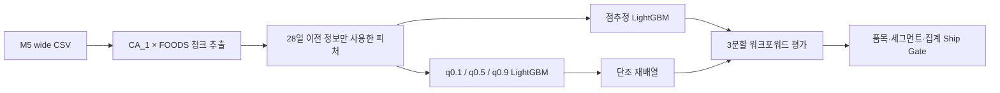
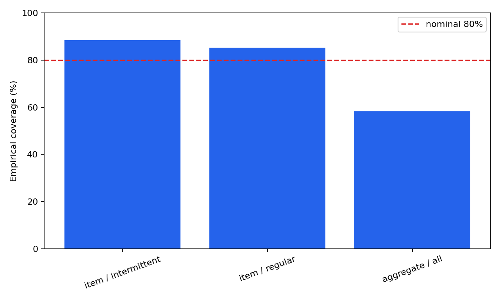
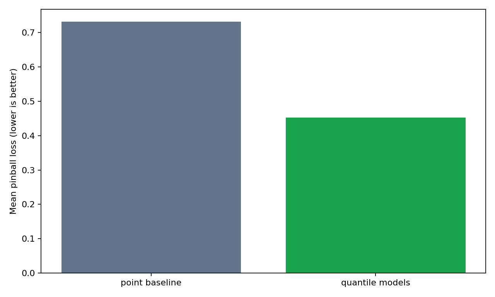

# WO-12 · 수요 분위수 예측 (Demand Quantile Forecasting)

> 개인 프로젝트 · 대응 직군: 데이터 사이언티스트(예측) · 데이터: M5 Forecasting Accuracy · 이용 조건: Kaggle competition rules

## 문제 정의

재고 운영에는 평균 수요 한 값뿐 아니라 과소 예측과 과대 예측 위험을 구분하는 범위가 필요하다. 이 프로젝트는 M5 판매량의 `CA_1 × FOODS` 1,437개 품목을 대상으로 점추정(point forecast)과 분위수 예측(quantile forecasting)을 같은 피처와 워크포워드 검증(walk-forward validation)에서 비교한다. `q0.1`과 `q0.9`로 만든 명목 80% 예측구간(prediction interval)이 실제 판매를 얼마나 포함하는지 분자와 분모까지 측정한다.

## 가설

1. 분위수별 LightGBM은 한 개 점추정을 세 분위수에 반복한 기준선보다 평균 핀볼 손실(pinball loss)이 낮을 것이다.
2. 첫 판매 이후 0 판매일 비율이 50% 이상인 간헐적 수요(intermittent demand)는 일반 품목과 커버리지(coverage)가 다를 것이다.
3. 품목 합계는 변동이 완화되므로 매장·카테고리 집계 레벨의 80% 구간이 품목 레벨보다 목표에 가까울 것이다.

## 접근 — 시도 순서

1. **점추정 기준선**: 동일한 판매·달력 피처로 제곱오차 LightGBM을 학습하고, 그 한 값을 `q0.1/q0.5/q0.9`에 반복해 퇴화 분포(degenerate distribution) 기준선을 만들었다.
2. **누수 점검**: `lag_1`, `lag_7`, 직전 이동평균은 28일 직접 다단계 예측(direct multi-step forecasting)에서 평가 구간의 미관측 값을 요구했다. 이를 제외하고 `lag_28/35/42/56`과 목표일에서 28일 전에 끝나는 이동 통계만 사용했다. 평가 구간 판매량을 바꿔도 피처가 변하지 않는 회귀 테스트를 추가했다.
3. **분위수 모델**: 같은 피처로 `q0.1/q0.5/q0.9` 모델을 각각 학습했다. 독립 모델에서 생긴 분위수 교차(quantile crossing)는 행별 단조 재배열(monotonic rearrangement)로 정렬하고 원시 교차율을 별도로 남겼다.
4. **워크포워드 검증**: 420개 학습 목표일과 28개 평가 목표일로 구성한 3개 순차 분할을 사용했다. 세 분할의 품목 평가 분모는 `1,437 × 28 × 3 = 120,708`건이다.
5. **세그먼트와 계층 비교**: 첫 판매 뒤 0 비율 50%를 고정 기준으로 간헐·일반 품목을 나누고, 별도 매장·카테고리 합계 모델도 같은 분할에서 평가했다.

## 데이터

- 공식 출처: [M5 Forecasting Accuracy](https://www.kaggle.com/competitions/m5-forecasting-accuracy/data)
- 재현 파일: `sales_train_evaluation.csv`, `calendar.csv`
- 범위: `CA_1` 매장, `FOODS` 카테고리, 1,437개 품목, 품목당 1,941개 판매 관측일
- 로딩: 2,000행 청크에서 조건에 맞는 행만 유지해 전체 M5 행렬을 긴 형식으로 펼치지 않는다.
- 무결성: 파일 크기와 SHA-256은 [DATA_VALIDATION.md](DATA_VALIDATION.md)에 기록했다.
- 내려받기: `python data/download.py`

## 파이프라인



```bash
docker compose run --rm pipeline
docker compose run --rm test
```

Docker 데몬을 사용할 수 없는 환경에서는 Python 3.11 가상환경에서 같은 명령을 실행할 수 있다.

```bash
python -m venv .venv
.venv/bin/pip install -r requirements.txt
.venv/bin/python data/download.py
.venv/bin/python run.py
.venv/bin/pytest -q
```

## 결과 (Ship Gate 표)

| 지표 | 목표·비교 기준 | 실제 |
|---|---:|---:|
| 품목 80% 구간 커버리지 | 80.00% | **86.82%** (104,795/120,708, +6.82%p) |
| 품목 평균 pinball loss | 점추정 기준선 0.7314 | **분위수 0.4522** (-38.17%) |
| 간헐적 수요 | 그룹별 별도 측정 | 커버리지 **88.43%**, pinball **0.2439** |
| 일반 수요 | 그룹별 별도 측정 | 커버리지 **85.24%**, pinball **0.6549** |
| 품목 레벨 | 커버리지 / pinball | **86.82% / 0.4522** |
| 매장·카테고리 집계 레벨 | 커버리지 / pinball | **58.33% / 81.7986** (49/84, -21.67%p) |
| 중앙 분위수 RMSE | 점추정 기준선 2.6854 | 분위수 `q0.5` **2.9256** (+8.95%) |

**측정 방식**: 3개 순차 분할에서 28일 직접 예측을 수행하고, 품목 120,708건과 집계 84건의 실제 판매량으로 커버리지·pinball loss·RMSE를 계산했다.





집계 레벨 pinball loss는 판매량 단위가 크므로 품목 절댓값과 직접 비교하지 않는다. 같은 레벨 안에서 점추정 대비 분위수 모델 개선율은 품목 38.17%, 집계 29.57%였다. RMSE에서는 점추정이 더 낮았고, pinball loss와 구간 정보에서는 분위수 모델이 유리했다. 따라서 재고 의사결정에는 평균 오차 하나보다 부족·초과 비용 방향을 반영하는 분위수 지표가 더 직접적이다.

## 시행착오와 의사결정

- **인증과 출처 분리**: Kaggle은 로그인과 규칙 동의를 요구했다. 공식 페이지를 기준 출처로 유지하고, 공개 미러를 전송 경로로 사용해 크기와 SHA-256을 고정했다.
- **가까운 시차 제거**: 일반적인 `lag_1/7` 피처는 28일 평가 구간 안의 실제 판매를 보게 된다. 정보 시점을 지키기 위해 모든 판매 피처가 예측 시작 전에 끝나도록 바꿨다.
- **집계 안정성 가설 기각**: 집계 구간이 더 안정적일 것으로 예상했지만 커버리지는 58.33%였다. 수치를 보정해 숨기지 않고, 원시 분위수 교차와 표본 수를 함께 남겼다.
- **지표별 결론 분리**: 분위수 모델은 pinball loss를 낮췄지만 `q0.5` RMSE는 높았다. 한 지표로 전체 성능을 대표하지 않고 운영 질문에 맞는 지표를 선택했다.

## 측정 경계 (한계)

- 평가 범위는 한 매장·한 카테고리이며, 다른 계층으로의 일반화는 추가 검증 대상이다.
- 집계 결과는 84개 관측에 기반해 품목 결과보다 표본 불확실성이 크다.
- 가격 피처와 계층 정합화(hierarchical reconciliation)는 포함하지 않았다.
- 단조 재배열은 분위수 순서만 보장하며 80% 커버리지를 목표에 맞추는 보정(calibration)은 수행하지 않는다.
- **다음 단계**: 매장·카테고리 확대, 적합 보정(conformal calibration), 스케일 핀볼 손실(scaled pinball loss), 품목 합계와 직접 집계 예측의 계층 정합화를 순서대로 비교한다.

## 개발 방식 (AI 활용 구분)

| 직접 작성한 것 | Codex가 생성한 것 |
|---|---|
| SONG: 문제 범위, Ship Gate 질문, M5·분위수 예측 요구사항 | 데이터 검증·청크 로더, 누수 방지 피처, LightGBM 학습·평가 파이프라인 |
| SONG: 포트폴리오 문서 규칙과 결과 전달 기준 | 단위·회귀 테스트, 실험 실행, 결과 표·시각화·근거 장부 |
| SONG: 최종 해석과 공개 여부 판단 | 대안 비교와 측정값 초안; 수치는 실행 산출물에서만 인용 |

## 용어집

| 용어 | 뜻 |
|---|---|
| 간헐적 수요 (intermittent demand) | 판매가 0인 날이 자주 나타나는 수요 패턴. 이 프로젝트에서는 첫 판매 뒤 0 비율이 50% 이상인 품목으로 고정했다. |
| 계층 정합화 (hierarchical reconciliation) | 품목 예측의 합과 상위 집계 예측이 일치하도록 조정하는 방법. 집계 커버리지 저하를 확인한 뒤의 검증 대상으로 남겼다. |
| 단조 재배열 (monotonic rearrangement) | 독립적으로 학습한 분위수 값이 `q0.1 ≤ q0.5 ≤ q0.9` 순서를 지키도록 정렬하는 처리다. |
| 분위수 교차 (quantile crossing) | 낮은 분위수 예측이 높은 분위수 예측보다 커지는 현상. 원시 발생률을 보존한 뒤 단조 재배열했다. |
| 분위수 예측 (quantile forecasting) | 조건부 분포의 여러 분위수를 직접 추정해 부족·초과 위험을 수치화하는 방식이다. |
| 스케일 핀볼 손실 (scaled pinball loss) | 시계열 규모 차이를 보정한 분위수 손실이다. 계층 간 비교의 다음 단계로 제안했다. |
| 워크포워드 검증 (walk-forward validation) | 시간 순서를 지키며 학습 종료점과 평가 구간을 앞으로 이동하는 검증 방식이다. |
| 적합 보정 (conformal calibration) | 별도 보정 자료의 오차를 이용해 목표 포함률에 맞게 예측구간 폭을 조정하는 방법이다. |
| 점추정 (point forecast) | 미래 수요를 한 값으로 예측하는 방식으로, 분포 기준선과 RMSE 비교에 사용했다. |
| 커버리지 (coverage) | 실제값이 예측구간 안에 포함된 비율이다. 이 프로젝트는 포함 건수와 전체 건수를 함께 기록한다. |
| 핀볼 손실 (pinball loss) | 목표 분위수에 따라 과소·과대 예측을 비대칭으로 벌점화하는 손실이다. |
| RMSE (Root Mean Squared Error) | 큰 점예측 오차에 더 큰 벌점을 주는 제곱평균제곱근오차다. 분위수 지표와 결론이 다른지 확인했다. |

## English Technical Summary

This project compares a squared-error LightGBM point baseline with three LightGBM quantile models on 1,437 `CA_1 × FOODS` M5 item series. Leakage-safe direct features use only sales known before each 28-step forecast origin, and three walk-forward folds produce 120,708 item-level observations. The `q0.1–q0.9` interval covered 86.82% of item outcomes, while mean pinball loss fell from 0.7314 to 0.4522. Intermittent items reached 88.43% coverage, regular items reached 85.24%, and the direct aggregate model reached only 58.33%. The failed aggregate-stability hypothesis is retained as evidence for calibration and hierarchical reconciliation work.
