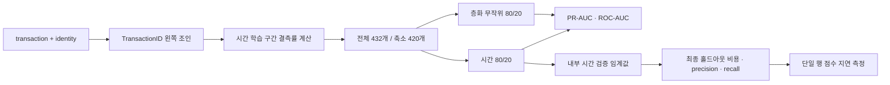
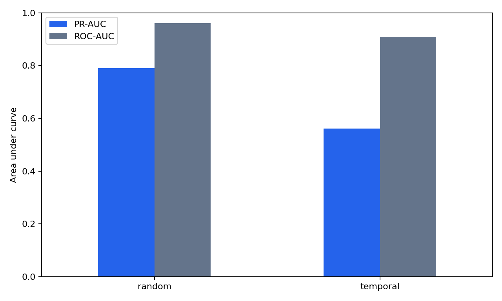
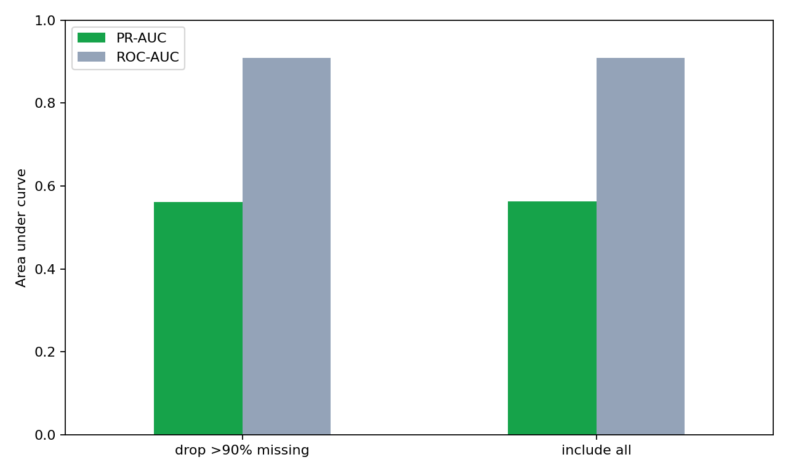
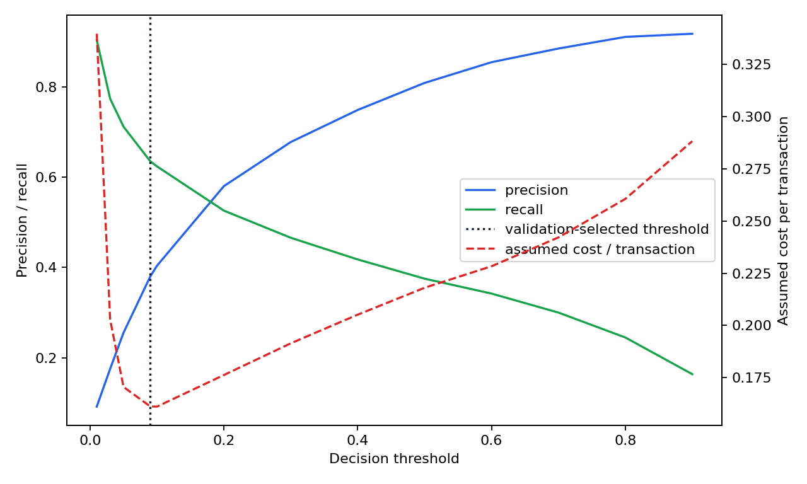

# WO-13 · 실시간 사기탐지 (Real-Time Fraud Detection)

> 개인 프로젝트 · 대응 직군: 데이터 사이언티스트, MLE · 데이터: IEEE-CIS Fraud Detection · 이용 조건: Kaggle competition rules

## 문제 정의

사기 거래 비율이 3.5%인 데이터에서는 정확도와 ROC-AUC만으로 운영 품질을 판단하기 어렵다. 이 프로젝트는 거래 시간 순서를 지킨 홀드아웃에서 정밀도-재현율 곡선 아래 면적(PR-AUC, Precision-Recall Area Under the Curve)을 주 지표로 사용하고, 오탐(false positive)과 미탐(false negative)의 비용 비대칭을 임계값(threshold)에 반영한다. 무작위 분할의 과대평가, 높은 결측률 피처의 실제 기여, 모델 점수 지연시간(latency)을 같은 실험에서 검증한다.

## 가설

1. 층화 무작위 분할은 시간 분할보다 PR-AUC를 높게 평가할 것이다.
2. 학습 구간에서 결측률이 90%를 넘는 피처는 제거해도 성능 차이가 작을 것이다.
3. 미탐 비용을 오탐의 10배로 가정하면 기본 임계값 0.5보다 낮은 비용 최소 임계값이 선택될 것이다.

## 접근 — 시도 순서

1. **원본 조인과 스키마 확인**: 거래 590,540건과 신원 144,233건을 `TransactionID`로 왼쪽 조인했다. 실제 조인 결과는 434열이며 식별자와 레이블을 제외한 432개 피처를 기준으로 삼았다.
2. **무작위 대조군**: 80/20 층화 무작위 분할에서 LightGBM을 학습해 PR-AUC 0.7907을 얻었다. 같은 모델을 `TransactionDT` 순서의 앞 80% 학습·뒤 20% 평가에 적용하자 0.5615로 낮아져, 무작위 결과를 운영 성능으로 채택하지 않았다.
3. **결측 피처 제거 실험**: 평가 구간을 보지 않고 시간 학습 구간에서 결측률을 계산했다. 90% 초과 12개를 제거하자 PR-AUC가 0.5632에서 0.5615로 0.165%p 낮아졌다. 축소 모델은 입력 의존성을 줄이는 운영 후보로 유지했다.
4. **비용 임계값 선택**: 최종 평가로 임계값을 고르는 누수를 피하려고 시간 학습 구간 안에 별도 검증 구간을 두었다. `FP×1 + FN×10`을 최소화한 0.09를 고정해 최종 20%에서 0.5와 비교했다.
5. **실시간 점수 계산 확인**: 학습 범주에 없거나 결측인 값을 명시적 범주 코드로 처리했다. 인코딩 완료 행렬의 단일 거래 모델 점수 계산을 500번 측정했다.

## 데이터

- 공식 출처: [IEEE-CIS Fraud Detection](https://www.kaggle.com/competitions/ieee-fraud-detection/data)
- 파일: `train_transaction.csv`, `train_identity.csv`
- 규모: 거래 590,540건, 사기 20,663건(3.4990%)
- 시간 변수: `TransactionDT`는 기준 시점부터의 경과 시간을 나타내며 실제 달력 시각은 제공하지 않는다.
- 평가 분모: 시간 평가 118,108건, 사기 4,064건(3.4409%)
- 무결성: 파일 크기·SHA-256·스키마는 [DATA_VALIDATION.md](DATA_VALIDATION.md)에 기록했다.
- 내려받기: `python data/download.py`

## 파이프라인



```bash
docker compose run --rm pipeline
docker compose run --rm test
```

Python 3.11 가상환경에서도 같은 결과를 재현할 수 있다.

```bash
python -m venv .venv
.venv/bin/pip install -r requirements.txt
.venv/bin/python data/download.py
.venv/bin/python run.py
.venv/bin/pytest -q
```

## 결과 (Ship Gate 표)

### 분할 방식 비교

| 분할 | 피처 | 평가 건수 | PR-AUC | ROC-AUC |
|---|---:|---:|---:|---:|
| 시간 80/20 | 420 | 118,108 | **0.5615** | **0.9086** |
| 층화 무작위 80/20 | 420 | 118,108 | **0.7907** | **0.9614** |
| 무작위 - 시간 | 동일 | 동일 | **+22.92%p** | **+5.28%p** |



### 결측 피처 포함·제외

| 시간 분할 피처 정책 | 피처 수 | PR-AUC | ROC-AUC | PR-AUC 변화 |
|---|---:|---:|---:|---:|
| 결측률 90% 초과 피처 포함 | 432 | **0.5632** | 0.9098 | 기준 |
| 결측률 90% 초과 12개 제거 | 420 | **0.5615** | 0.9086 | **-0.165%p** |



### 임계값별 운영 결과

비용은 실제 화폐가 아니라 **오탐 1건당 1단위, 미탐 1건당 10단위**라는 분석 가정이다. 임계값 0.09는 최종 평가가 아닌 학습 구간 내부 시간 검증에서 선택했다.

| 임계값 | Precision | Recall | 오탐 | 미탐 | 가정 비용 |
|---:|---:|---:|---:|---:|---:|
| 0.01 | 0.0921 | 0.9035 | 36,194 | 392 | 40,114 |
| 0.03 | 0.1757 | 0.7736 | 14,749 | 920 | 23,949 |
| 0.05 | 0.2556 | 0.7116 | 8,422 | 1,172 | 20,142 |
| **0.09** | **0.3802** | **0.6351** | **4,208** | **1,483** | **19,038** |
| 0.10 | 0.4039 | 0.6238 | 3,741 | 1,529 | 19,031 |
| 0.20 | 0.5801 | 0.5258 | 1,547 | 1,927 | 20,817 |
| **0.50** | **0.8086** | **0.3752** | **361** | **2,539** | **25,751** |
| 0.90 | 0.9174 | 0.1639 | 60 | 3,398 | 34,040 |

검증에서 고른 0.09는 최종 평가에서 기본 0.5보다 미탐을 1,056건 줄이고 오탐을 3,847건 늘렸다. 가정 비용은 **6,713단위, 26.07% 감소**했다. 평가 구간만 보면 0.10이 7단위 낮지만, 이를 사후 최적값으로 바꾸지 않았다.



### 추론 지연

| 측정 | 실제 |
|---|---:|
| 118,108건 배치 합계 | 298.60ms |
| 배치 건당 | 0.00253ms |
| 단일 행 p50 | 0.0426ms |
| 단일 행 p95 | **0.0545ms** |

**측정 방식**: 전체 IEEE-CIS 학습 자료에서 고정 LightGBM 설정을 사용했으며, 성능은 시간 홀드아웃 118,108건, 비용 임계값은 분리된 내부 시간 검증, 지연은 인코딩 완료 입력의 로컬 CPU 모델 점수 계산으로 측정했다.

## 시행착오와 의사결정

- **PR-AUC를 주 지표로 채택**: 시간 평가에서 ROC-AUC는 0.9086이지만 PR-AUC는 0.5615였다. 평가 사기 비율 3.4409%에서 양성 예측 품질을 직접 보는 PR-AUC로 모델을 판단했다.
- **무작위 분할을 대조군으로 제한**: 무작위 PR-AUC는 시간 분할보다 22.92%p 높았다. 같은 모델에서도 검증 방식이 운영 기대치를 크게 바꿀 수 있음을 수치로 남겼다.
- **결측률만으로 정보성을 단정하지 않음**: 12개를 제거했을 때 성능이 개선되지 않고 0.165%p 낮아졌다. 축소 모델의 가치는 정확도 향상이 아니라 입력 의존성 감소로 해석했다.
- **평가 구간 사후 최적화 방지**: 최종 평가에서 0.10이 0.09보다 비용 7단위 낮았지만, 내부 검증에서 고른 0.09를 유지했다.
- **범주형 경고와 지연 측정 수정**: 결측 범주의 음수 코드와 단일 행 판다스 변환을 제거해 범주 처리를 명시하고 모델 점수 지연만 측정했다.

## 측정 경계 (한계)

- 비용 비율 1:10은 민감도 분석을 위한 단위 가정이며 실제 고객 불편·사기 손실 금액은 조직별로 다시 산정해야 한다.
- 단일 시간 홀드아웃 결과이므로 여러 시간 창의 변동성은 추가 검증 대상이다.
- 지연 측정은 특성 조회, 네트워크, 직렬화 이전의 모델 점수 계산 범위다.
- LightGBM gain 중요도는 모델이 자주 활용한 피처를 보여주며 원인 효과를 뜻하지 않는다.
- **다음 단계**: 롤링 시간 검증, 비용 비율별 임계값 민감도, 확률 보정(probability calibration), 온라인 피처 조회를 포함한 종단 지연 측정을 순서대로 추가한다.

## 개발 방식 (AI 활용 구분)

| 직접 작성한 것 | Codex가 생성한 것 |
|---|---|
| SONG: 프로젝트 질문, Ship Gate, 데이터·모델 방향 | 원본 검증, 시간·무작위 분할, 학습 전용 인코딩, LightGBM 파이프라인 |
| SONG: 비용 기반 판단 요구와 공개 문서 규칙 | 비용 행렬·임계값 검증, 지연 측정, 회귀 테스트, 결과 시각화 |
| SONG: 최종 해석과 공개 여부 판단 | 근거 장부와 판단 장면 초안; 수치는 실행 산출물에서만 인용 |

## 용어집

| 용어 | 뜻 |
|---|---|
| 결측 피처 제거 실험 (missing-feature ablation) | 결측률이 높은 피처를 포함하거나 제거해 실제 성능 기여와 입력 의존성을 분리해 보는 비교다. |
| 비용 행렬 (cost matrix) | 오탐과 미탐에 서로 다른 비용을 부여하는 규칙이다. 이 프로젝트에서는 1:10 단위를 가정했다. |
| 무작위 분할 (random split) | 행의 시간 순서를 섞어 학습·평가를 나누는 방식이다. 시간 분할 과대평가 정도를 재는 대조군으로 사용했다. |
| 미탐 (false negative) | 실제 사기 거래를 정상으로 통과시킨 경우다. 가정 비용에서 오탐보다 10배 높은 벌점을 줬다. |
| 불균형 데이터 (imbalanced data) | 클래스 비율 차이가 큰 데이터다. 사기 비율 3.4990% 때문에 정확도보다 PR-AUC를 우선했다. |
| 시간 분할 (temporal split) | 과거 거래로 학습하고 이후 거래로 평가하는 분할이다. 배포 시점의 정보 흐름을 재현한다. |
| 오탐 (false positive) | 정상 거래를 사기로 차단한 경우다. 고객 불편을 나타내는 1단위 비용을 가정했다. |
| 임계값 (threshold) | 사기 확률을 차단 판단으로 바꾸는 경계다. 비용 비율에 따라 precision과 recall의 교환 지점이 달라진다. |
| 정밀도 (precision) | 사기로 차단한 거래 중 실제 사기의 비율이다. 임계값을 낮추면 일반적으로 낮아진다. |
| 재현율 (recall) | 실제 사기 중 탐지한 비율이다. 미탐 비용이 클 때 우선할 수 있는 지표다. |
| 확률 보정 (probability calibration) | 예측 확률과 실제 발생 비율을 맞추는 절차다. 비용 임계값의 이전 가능성을 높이는 다음 단계다. |
| PR-AUC (Precision-Recall Area Under the Curve) | 임계값 전 범위의 precision-recall 관계를 요약한다. 희귀 사기 클래스의 탐지 품질을 주 지표로 측정했다. |
| ROC-AUC (Receiver Operating Characteristic Area Under the Curve) | 임계값 전 범위의 참양성률과 거짓양성률 관계를 요약한다. PR-AUC와 함께 보고하되 주 판단 지표로 사용하지 않았다. |

## English Technical Summary

This project evaluates LightGBM fraud detection on all 590,540 IEEE-CIS transactions while preserving deployment-time ordering. A stratified random holdout produced 0.7907 PR-AUC, whereas the chronological holdout reached 0.5615, a 22.92 percentage-point gap. Removing 12 features with more than 90% training-window missingness reduced temporal PR-AUC by 0.165 percentage points. With an explicit false-positive cost of 1 and false-negative cost of 10, a threshold of 0.09 selected on an inner chronological validation window reduced untouched holdout cost by 26.07% versus 0.5. Encoded single-row model scoring measured 0.0545 ms at p95; feature retrieval and network latency remain the next measurement boundary.
