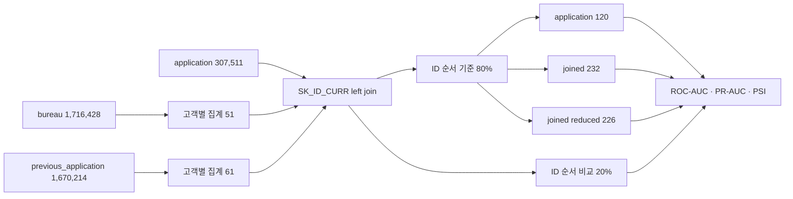
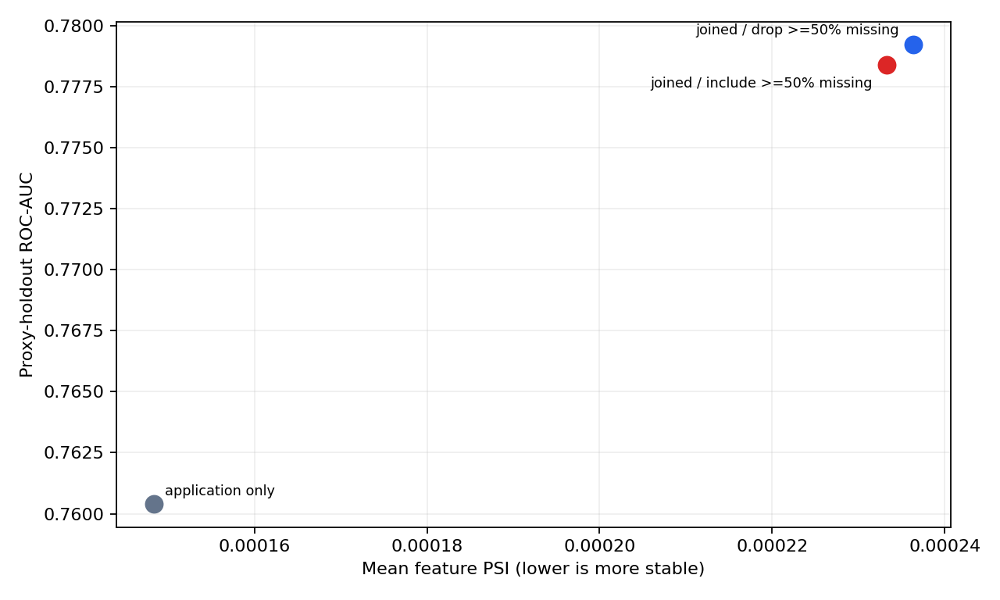
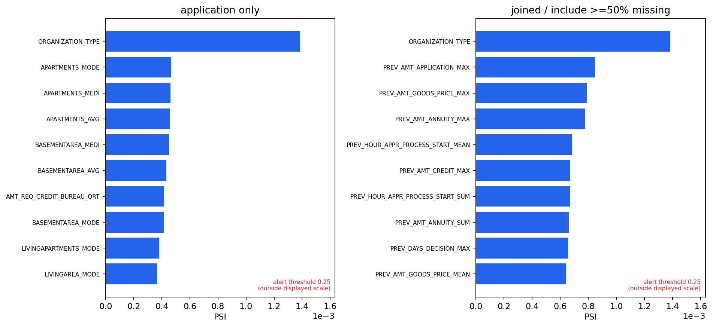
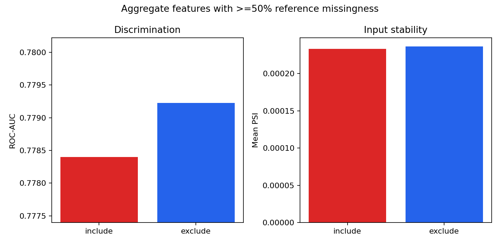

# WO-14 · 신용평가 모델 안정성 (Credit Model Stability)

> WO-06은 단일 신청 테이블에서 WoE 스코어카드와 LightGBM을 비교했고, WO-14는 `application`·`bureau`·`previous_application`의 다중 테이블 조인이 판별력과 입력 안정성에 주는 변화를 검증한다.

## 문제 정의

신용평가 모델에 연관 이력을 붙이면 고객의 부채·신청 행동을 더 잘 표현할 수 있지만, 결측과 분포 변화에 노출되는 입력도 늘어난다. 이 프로젝트는 Home Credit 신청 307,511건에 신용국 이력 1,716,428건과 이전 신청 1,670,214건을 고객별로 집계해 조인하고, 같은 비교 코호트에서 수신자 조작 특성 곡선 아래 면적(ROC-AUC, Receiver Operating Characteristic Area Under the Curve)과 모집단 안정성 지수(PSI, Population Stability Index)를 함께 측정한다.

실제 신청 시점은 제공되지 않는다. 따라서 `SK_ID_CURR` 오름차순의 작은 ID 80%를 기준 코호트, 큰 ID 20%를 비교 코호트로 둔 **분포 스트레스 테스트**이며 실제 시간 검증이나 운영 성능 저하의 증거가 아니다.

## 가설

1. `bureau`와 `previous_application` 집계 피처를 조인하면 application 단독 모델보다 ROC-AUC가 높아질 것이다.
2. 기준 코호트 결측률이 50% 이상인 집계 피처를 포함하면 PSI가 더 불안정해질 것이다.
3. 조인으로 얻는 AUC 이득과 PSI 악화 사이에 수치로 확인 가능한 트레이드오프가 있을 것이다.

## 접근 — 시도 순서

1. **신청 단독 기준선**: 식별자와 타깃을 뺀 application 피처 120개로 LightGBM을 학습했다.
2. **연관 이력 집계**: `bureau` 12개 수치 필드와 `previous_application` 14개 수치 필드를 고객별 평균·최솟값·최댓값·합으로 집계했다. 레코드 수, 신용 활성 비율, 계약 상태 비율도 더해 집계 피처 112개를 만들었다.
3. **행 보존 조인**: 두 집계 테이블을 `SK_ID_CURR` 기준으로 왼쪽 조인하고 `one_to_one` 검증으로 신청 307,511건이 보존되는지 확인했다.
4. **동일 모델·동일 코호트 비교**: 세 변형 모두 300-tree LightGBM과 같은 ID 순서 80/20 코호트를 사용했다. 범주 사전은 기준 코호트에서만 만들었다.
5. **PSI 측정**: 수치형은 기준 코호트 10분위 구간, 범주형은 범주별 구간, 결측은 독립 구간으로 계산했다. 두 분포의 0 비율은 `1e-6`으로 평활했다.
6. **결측 제거 실험**: 기준 코호트에서 결측률 50% 이상인 집계 피처 6개를 제외한 세 번째 모델을 동일 조건으로 측정했다.

## 데이터

- 정본: [Home Credit Default Risk](https://www.kaggle.com/competitions/home-credit-default-risk/data)
- 이용 조건: Kaggle competition rules
- 타깃: `TARGET=1`, 상환 어려움 발생; 전체 비율 8.0729%
- 기준 코호트: 246,008건, 양성 19,941건(8.1058%)
- 비교 코호트: 61,503건, 양성 4,884건(7.9411%)
- 무결성: 파일별 행·열·바이트·SHA-256은 [DATA_VALIDATION.md](DATA_VALIDATION.md)에 기록했다.
- 재현: `python data/download.py`; 원본 파일은 Git에 커밋하지 않는다.

## 파이프라인



```bash
python -m venv .venv
.venv/bin/pip install -r requirements.txt
.venv/bin/python data/download.py
.venv/bin/python run.py
.venv/bin/pytest
```

Docker Compose에서도 같은 실행 경로를 사용한다.

```bash
docker compose run --rm pipeline
docker compose run --rm test
```

## 결과 (Ship Gate)

### 기준 모델과 확장 모델 AUC·PSI

| 모델 | 전체 피처 | 집계 피처 | ROC-AUC | PR-AUC | 평균 PSI | PSI p95 | PSI > 0.25 |
|---|---:|---:|---:|---:|---:|---:|---:|
| application 단독 | 120 | 0 | 0.7604 | 0.2415 | 0.000148 | 0.000418 | 0 |
| 조인 · 고결측 포함 | 232 | 112 | **0.7784** | **0.2659** | 0.000233 | 0.000595 | 0 |
| 조인 · 고결측 제외 | 226 | 106 | **0.7792** | **0.2666** | 0.000236 | 0.000596 | 0 |

조인 모델은 기준선보다 ROC-AUC **1.801%p**, PR-AUC **2.444%p** 높았다. 평균 PSI는 **0.000085**, p95 PSI는 **0.000177** 증가했지만 최대 PSI도 0.001385여서 관례적 경보선 0.25와 큰 차이가 있다. 이 결과는 **판별력 향상은 확인하지만 의미 있는 안정성 악화는 확인하지 못했다**는 결론을 지지한다.



### 피처별 PSI 상위 10개

| 순위 | application 단독 피처 | PSI | 조인 확장 피처 | 출처 | PSI |
|---:|---|---:|---|---|---:|
| 1 | `ORGANIZATION_TYPE` | 0.001385 | `ORGANIZATION_TYPE` | application | 0.001385 |
| 2 | `APARTMENTS_MODE` | 0.000468 | `PREV_AMT_APPLICATION_MAX` | previous | 0.000847 |
| 3 | `APARTMENTS_MEDI` | 0.000462 | `PREV_AMT_GOODS_PRICE_MAX` | previous | 0.000788 |
| 4 | `APARTMENTS_AVG` | 0.000456 | `PREV_AMT_ANNUITY_MAX` | previous | 0.000779 |
| 5 | `BASEMENTAREA_MEDI` | 0.000452 | `PREV_HOUR_APPR_PROCESS_START_MEAN` | previous | 0.000684 |
| 6 | `BASEMENTAREA_AVG` | 0.000432 | `PREV_AMT_CREDIT_MAX` | previous | 0.000673 |
| 7 | `AMT_REQ_CREDIT_BUREAU_QRT` | 0.000417 | `PREV_HOUR_APPR_PROCESS_START_SUM` | previous | 0.000668 |
| 8 | `BASEMENTAREA_MODE` | 0.000413 | `PREV_AMT_ANNUITY_SUM` | previous | 0.000660 |
| 9 | `LIVINGAPARTMENTS_MODE` | 0.000382 | `PREV_DAYS_DECISION_MAX` | previous | 0.000655 |
| 10 | `LIVINGAREA_MODE` | 0.000365 | `PREV_AMT_GOODS_PRICE_MEAN` | previous | 0.000643 |



### 결측률 50% 이상 집계 피처 포함·제외

| 정책 | 제거 수 | ROC-AUC | PR-AUC | 평균 PSI | PSI p95 |
|---|---:|---:|---:|---:|---:|
| 포함 | 0 | 0.778398 | 0.265949 | 0.000233 | 0.000595 |
| 6개 제외 | 6 | 0.779224 | 0.266551 | 0.000236 | 0.000596 |
| 제외 - 포함 | — | **+0.0826%p** | **+0.0602%p** | **+0.000003** | **+0.000001** |

제거 대상 6개의 평균 PSI는 0.000118로 전체 조인 입력 평균보다 낮았다. 따라서 제거 모델의 평균 PSI가 아주 작게 오른 것은 불안정성이 생긴 것이 아니라 **낮은 PSI 피처가 평균의 분모에서 빠진 구성 효과**다. “고결측 집계 피처가 PSI를 악화시킨다”는 두 번째 가설은 이 코호트에서 기각한다. 6개 제거는 AUC도 소폭 높여 축소 모델을 배포 후보로 선택할 근거가 된다.



### 트레이드오프 요약

- **얻은 것**: 집계 112개 추가 시 ROC-AUC +1.801%p, PR-AUC +2.444%p
- **변한 것**: 평균 PSI +0.000085, p95 PSI +0.000177
- **확인하지 못한 것**: 모든 입력의 PSI가 0.25 미만이므로 운영상 의미 있는 PSI 악화
- **선택**: 고결측 집계 6개를 제거한 226피처 모델. 성능은 포함 모델보다 소폭 높고 입력 계약은 더 작다.

원시 수치는 [model_metrics.csv](results/model_metrics.csv), [feature_psi.csv](results/feature_psi.csv), [top_10_psi.csv](results/top_10_psi.csv), [tradeoff_summary.json](results/tradeoff_summary.json)에 분리해 두었다.

## 시행착오와 의사결정

- **실제 시간을 만들지 않음**: `DAYS_BIRTH`나 `DAYS_EMPLOYED`로 시간 축을 대신하면 고객 생애주기 집단 차이를 드리프트로 오인한다. 식별자 순서는 시간이라는 보장이 없으므로 ID 코호트를 스트레스 테스트로만 명명했다.
- **PSI 공식을 직접 구현**: WO-06과 PSI 정의는 맞추되, WoE 구간화가 없는 실험에 `optbinning` 의존성을 추가하지 않았다. 기준 코호트 분위 구간·결측 구간·평활 상수를 코드와 테스트로 고정해 계산 근거를 노출했다.
- **조인 수로 품질을 과장하지 않음**: 112개 집계 피처를 추가한 모델에서 ROC-AUC가 올랐지만, 실제 시간 검증이 아니므로 “배포 안정성 확보”로 해석하지 않았다.
- **예상과 다른 고결측 결과 유지**: 결측률 50% 이상 6개를 제거하자 평균 PSI가 0.000003 올랐다. 제거 피처의 PSI가 오히려 낮았다는 구성 효과를 확인하고 가설을 사후 변경하지 않았다.

## 측정 경계 (한계)

- Home Credit의 신청 시점이 익명화돼 실제 시간 순서, 월별 AUC 저하, 재학습 시점을 측정할 수 없다.
- `SK_ID_CURR` 순서는 자료 내부의 결정론적 코호트 경계일 뿐 시간의 대리 변수라는 보장이 없다.
- PSI는 입력 분포 차이를 재며 성능 저하나 원인을 직접 증명하지 않는다. 현재 최대 0.001385는 선택한 두 코호트가 매우 유사했음을 뜻한다.
- 모델 비교는 단일 80/20 코호트와 고정 하이퍼파라미터에서 수행했으며 신뢰구간을 포함하지 않는다.
- `bureau_balance` 등 월별 잔액 테이블은 범위에서 제외했다. 실제 시간 키가 있는 자료로 롤링 검증을 구성하는 것이 다음 검증 단계다.

## 개발 방식 (AI 활용 구분)

| 직접 정의한 것 | Codex가 생성한 것 |
|---|---|
| SONG: 다중 테이블 안정성 질문, Ship Gate, 고결측 50% 기준 | 데이터 해시 검증, 고객별 집계, 누수 방지 인코딩, 고정 LightGBM 비교 코드 |
| SONG: WO-06과의 구분 및 포트폴리오 공개 방향 | PSI 직접 구현, 회귀 테스트, 결과 표·시각화, 근거 장부 초안 |
| SONG: 결과 채택과 공개 여부 판단 | 실행 산출물에서만 수치를 읽어 가설 지지 여부와 측정 경계 정리 |

## 용어집

| 용어 | 뜻 |
|---|---|
| 기준 코호트 (reference cohort) | PSI 구간과 모델을 만드는 246,008건의 ID 순서 집단이다. 실제 시간상 과거 집단을 뜻하지 않는다. |
| 고결측 피처 (high-missing feature) | 기준 코호트에서 값의 50% 이상이 비어 있는 집계 피처다. |
| 다중 테이블 조인 (multi-table join) | 신청 한 행에 여러 신용국·이전 신청 행을 고객별로 집계해 결합하는 과정이다. |
| 모집단 안정성 지수 (Population Stability Index, PSI) | 기준 분포와 비교 분포의 구간별 비율 차이를 로그 비율로 가중해 더한 지표다. 낮을수록 두 입력 분포가 유사하다. |
| 비교 코호트 (comparison cohort) | 모델 성능과 PSI를 측정하는 61,503건의 ID 순서 집단이다. 실제 운영 시점을 뜻하지 않는다. |
| 분포 스트레스 테스트 (distribution stress test) | 시간 인과를 주장하지 않고 정해진 두 집단의 입력 분포와 모델 성능 차이를 확인하는 검사다. |
| 수신자 조작 특성 곡선 아래 면적 (Receiver Operating Characteristic Area Under the Curve, ROC-AUC) | 모든 임계값에서 정상과 부실 신청을 순위화하는 능력을 요약한다. |
| 정밀도-재현율 곡선 아래 면적 (Precision-Recall Area Under the Curve, PR-AUC) | 양성 클래스의 정밀도와 재현율 관계를 요약하며 불균형 자료에서 보조 판별 지표로 사용했다. |
| 평활 (smoothing) | 어떤 PSI 구간의 관측 비율이 0일 때 로그 계산이 발산하지 않도록 작은 값 `1e-6`을 적용하는 처리다. |

## English Technical Summary

This project measures the discrimination and input stability effects of joining Home Credit application, bureau, and previous-application histories. Customer-level aggregates add 112 features to the 120-feature application baseline. On the same deterministic ID-ordered proxy holdout, ROC-AUC increases from 0.7604 to 0.7784 and PR-AUC from 0.2415 to 0.2659. Mean feature PSI increases by only 0.000085, while every feature remains below 0.25; the expected material stability tradeoff is therefore not supported. Removing six aggregate features with at least 50% reference-cohort missingness raises ROC-AUC to 0.7792. Because no application timestamp is available, the split is explicitly a distribution-stress proxy rather than temporal validation or evidence of production drift.

