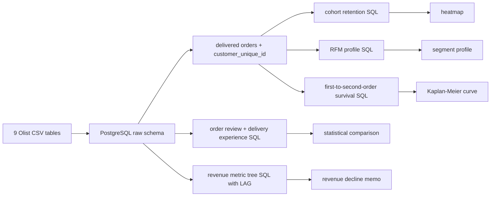
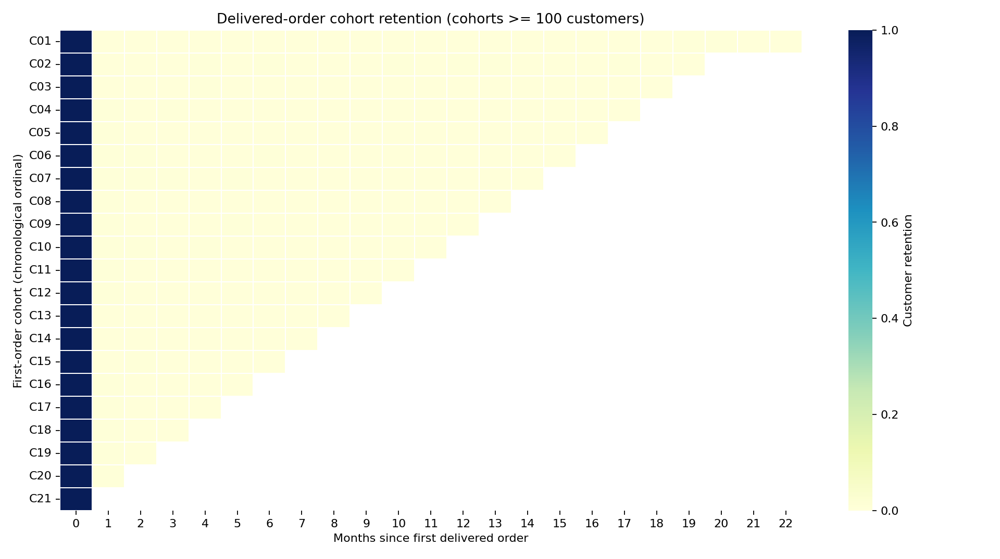
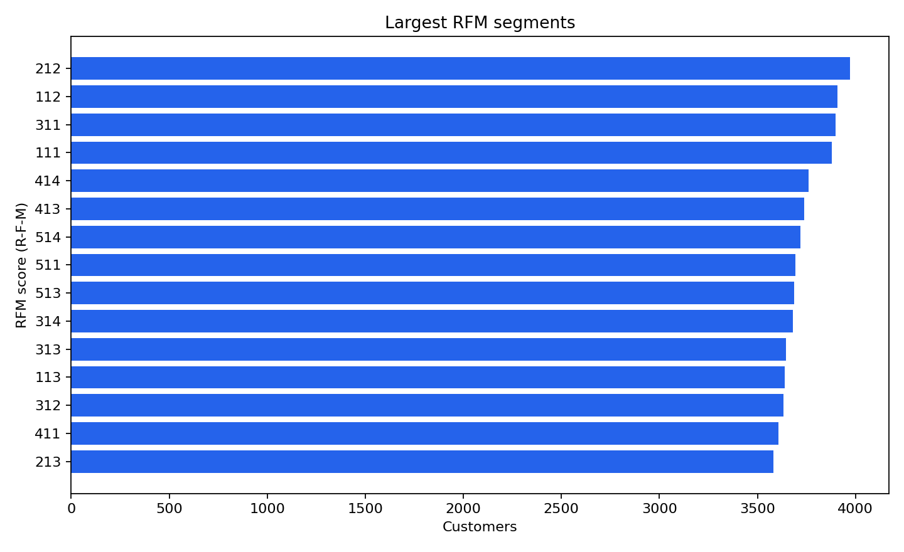
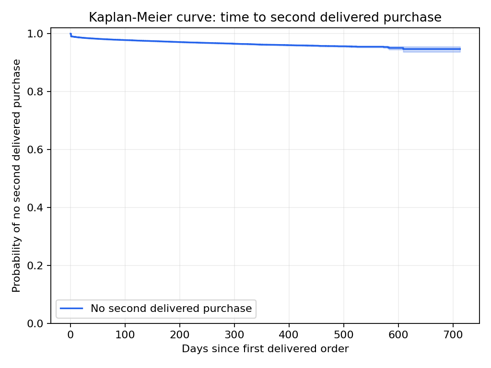
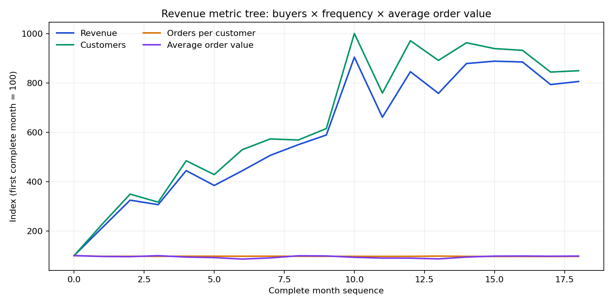

# WO-15 · 코호트·리텐션 분석 (Cohort & Retention Analysis)

> 개인 프로젝트 · 대응 직군: 데이터 분석가 · 데이터: Olist Brazilian E-Commerce Public Dataset, Kaggle 공개 데이터셋 조건 적용

## 문제 정의

기존 고객을 유지하는 편이 신규 고객을 얻는 것보다 효율적이라는 주장은 실제 구매 주기와 재구매 수준을 확인한 뒤 평가해야 한다. Olist 마켓플레이스 주문 자료로 첫 배송 완료 구매월을 기준으로 고객 코호트를 만들고, 재구매율·고객 가치·첫 주문 경험 차이를 SQL로 측정했다.

고객 식별자(customer identifier)는 `customer_id`가 아니라 `customer_unique_id`를 사용한다. 전자는 주문마다 새로 발급되고 후자는 여러 주문을 같은 고객으로 연결한다. 구매 이벤트는 취소·미배송 주문과 구분하기 위해 `delivered` 상태로 한정했다.

## 가설

1. `customer_id`를 고객 키로 쓰면 재구매를 놓치며, `customer_unique_id`로 묶었을 때도 재구매율은 낮을 것이다.
2. 첫 배송 완료 구매월 기준 코호트 리텐션은 다음 달부터 낮게 나타날 것이다.
3. 첫 주문 리뷰와 배송 지연은 재구매군과 1회 구매군 사이에 차이가 있을 수 있지만, 관찰자료만으로 원인을 설명할 수는 없다.

## 접근 — 시도 순서

1. **식별자 함정 확인**: 전체 주문 99,441개를 `customer_id`로 세면 반복 고객이 0명이다. `customer_unique_id`로 묶어 96,096명을 얻었고 반복 고객 2,997명(3.1188%)을 확인했다.
2. **완료 구매 정의**: 코호트·RFM·생존 분석에서는 배송 완료 주문만 구매로 정했다. 이 기준의 고객은 93,358명, 반복 고객은 2,801명(3.0003%)이다. 모든 상태를 포함한 재구매율과 분모 차이를 별도로 공개했다.
3. **SQL 코호트 리텐션**: 첫 배송 완료 구매월을 고정 코호트로 만들고, 초기 코호트 고객 수를 분모로 월별 활동 고객 비율을 계산했다. 월별 지표에는 `DATE_TRUNC`, `FIRST_VALUE`와 `LAG` 윈도 함수를 사용했다.
4. **관측 끝과 초기 표본 처리**: 마지막 관측 월은 부분 월이므로 매출 분해에서 제외했다. 매출 변동은 월 500건 이상인 세 달 연속 구간부터 비교해 초기의 희소한 관측과 달력상 공백이 만든 허위 급락을 막았다. 히트맵에서는 코호트 크기 100명 미만 두 집단을 숨김 표시했다.
5. **RFM (Recency, Frequency, Monetary) 점수와 생존 분석(survival analysis)**: Frequency는 1회 구매가 대부분인 동률 분포를 임의로 5분위로 쪼개지 않고 1회/반복의 두 단계로 기록했다. 재구매가 관측되지 않은 고객은 분석 종료 시점에 우측 중도절단(right-censoring)으로 처리했다.
6. **첫 주문 경험 비교**: 고객별 첫 배송 완료 주문의 리뷰 점수는 Welch t-검정, 배송 지연 여부는 카이제곱 검정(chi-square test)으로 비교했다.

## 데이터

- 정본: [Olist Brazilian E-Commerce Public Dataset](https://www.kaggle.com/datasets/olistbr/brazilian-ecommerce)
- 이용 조건: 데이터셋에 명시된 CC BY-NC-SA 조건과 현재 Kaggle 약관을 확인한다.
- 9개 CSV를 PostgreSQL에 적재했다: 주문 99,441건, 고객 99,441건, 주문 상품 112,650건, 결제 103,886건, 리뷰 99,224건, 상품 32,951건, 판매자 3,095건, 지리정보 1,000,163건, 카테고리 번역 71건.
- 구매 시점은 약 2년 범위다. 마지막 관측일의 고객은 추적 기회가 짧아 리텐션이 구조적으로 낮게 보일 수 있다.
- 파일별 크기·SHA-256과 분모 정의는 [DATA_VALIDATION.md](DATA_VALIDATION.md)에 남겼다. 원본과 고객 단위 추출물은 Git에 포함하지 않는다.

## 파이프라인



### 실행

Docker Desktop이 실행 중인 상태에서 프로젝트 폴더에서 명령합니다.

```bash
python -m venv .venv
.venv/bin/pip install -r requirements.txt
.venv/bin/python data/download.py
docker compose up -d --wait db
.venv/bin/python run.py
```

`run.py`는 PostgreSQL 테이블을 적재하고 SQL 분석을 만든 다음 집계 결과와 그림, 의사결정 메모를 `results/`에 저장한다. 전체 SQL은 [sql/02_analysis.sql](sql/02_analysis.sql)에 있다. 데이터 적재 후 분석만 다시 실행할 때는 `.venv/bin/python run.py --skip-load`를 사용한다.

## 결과 (Ship Gate 표)

### 코호트 리텐션

분모는 최초 배송 완료 구매월의 고객 수다. 다음 달 관측이 가능한 22개 코호트의 합산 고객 87,214명 중 421명이 돌아와 가중 리텐션은 **0.483%**였다. 세 달 후는 **0.255%**, 6개월 후 **0.232%**, 12개월 후 **0.166%**였다. 코호트 크기 100명 미만인 두 행은 시각화에서 제외했지만 CSV에는 보존했다.

| 최초 구매 후 경과 월 | 관측 가능한 코호트 수 | 초기 고객 수 합 | 재방문 고객 수 합 | 가중 리텐션 |
|---:|---:|---:|---:|---:|
| 0 | 23 | 93,358 | 93,358 | 100.000% |
| 1 | 22 | 87,214 | 421 | **0.483%** |
| 2 | 21 | 81,265 | 273 | **0.336%** |
| 3 | 20 | 75,387 | 192 | **0.255%** |
| 6 | 17 | 55,525 | 129 | **0.232%** |
| 12 | 11 | 21,665 | 36 | **0.166%** |



### 고객 키와 재구매율

| 주문 상태 범위 | 식별자 | 고객 수 | 반복 주문 고객 | 재구매율 |
|---|---|---:|---:|---:|
| 전체 주문 | `customer_id` | 99,441 | 0 | 0.000% |
| 전체 주문 | `customer_unique_id` | 96,096 | 2,997 | **3.119%** |
| 배송 완료 주문 | `customer_id` | 96,478 | 0 | 0.000% |
| 배송 완료 주문 | `customer_unique_id` | 93,358 | 2,801 | **3.000%** |

주 결과의 구매 정의는 배송 완료다. 전체 주문을 대상으로 공개 분석에서 보고된 약 3%와 비슷한 방향이며, 실제 집계값은 상태 필터에 따라 달라진다.

### RFM 세그먼트

금액은 결제 테이블의 고객별 `payment_value` 합계다. RFM의 Frequency 점수는 한 번 구매한 고객을 1, 재구매 고객을 5로 두어 동일 빈도 고객을 인위적으로 나누지 않았다. Recency와 Monetary는 5분위 점수다.

| R-F-M 점수 | 고객 수 | 평균 Recency (일) | 평균 구매 횟수 | 평균 결제액 | 재구매율 |
|---|---:|---:|---:|---:|---:|
| 212 | 3,972 | 317.87 | 1.000 | 70.43 | 0.000% |
| 112 | 3,907 | 471.57 | 1.000 | 70.97 | 0.000% |
| 311 | 3,900 | 219.15 | 1.000 | 39.54 | 0.000% |
| 111 | 3,879 | 476.45 | 1.000 | 39.71 | 0.000% |
| 414 | 3,761 | 136.62 | 1.000 | 165.70 | 0.000% |

가장 큰 세그먼트도 모두 1회 구매 고객이다. RFM은 지출과 마지막 구매 후 경과일별 고객 프로파일에는 유용하지만, 이 자료에서 높은 재구매 가능성 집단을 넓게 식별하는 데는 제한적이었다.



### 재구매 생존 분석

| 관측값 | 결과 |
|---|---:|
| 배송 완료 고객 | 93,358 |
| 두 번째 배송 완료 주문 관측 | 2,801 |
| 두 번째 주문 전 중도절단 | 90,557 |
| 90일 시점 두 번째 주문 미관측 생존확률 | 97.87% |
| 180일 시점 두 번째 주문 미관측 생존확률 | 97.24% |
| 중앙 재구매 대기시간 | 관측 종료 전 도달하지 않음 |

Kaplan-Meier 추정은 관측 종료까지 재구매가 없었다고 확정하지 않고 마지막 관측 시점에서 우측 중도절단한다.



### 첫 주문 리뷰·배송 지연 비교

| 첫 주문 지표 | 1회 구매 고객 | 재구매 고객 | 차이 (재구매 - 1회) | 검정 | p-value |
|---|---:|---:|---:|---|---:|
| 리뷰 점수 평균 | 4.152 (n=89,955) | 4.200 (n=2,780) | +0.048점 | Welch t-검정 | 0.0468 |
| 배송 지연 비율 | 8.187% (n=90,549) | 6.855% (n=2,801) | -1.332%p | 카이제곱 | 0.0123 |

리뷰 점수 차이는 통계적으로 경계에 가깝지만 크기는 0.048점으로 작다. 두 결과 모두 고객 구성·상품 유형 등 다른 요인을 통제하지 않은 연관이며 원인 효과로 해석하지 않는다.

### 매출 지표 트리 (revenue metric tree)

매출은 `고객 수 × 고객당 배송 완료 주문 수 × 주문당 결제액`으로 분해했다. 초기의 희소한 거래와 마지막 부분 월을 제외하고, 월 500건 이상인 세 달 연속 활동이 확인된 구간의 완전한 월만 비교했다.

| 매출 하락 사례 | 직전 월 | 비교 월 | 변화 |
|---|---:|---:|---:|
| 결제액 합계 | 1,153,528.05 | 843,199.17 | **-26.90%** |
| 고객 수 | 7,183 | 5,450 | -24.10% |
| 고객당 주문 수 | 1.0148 | 1.0116 | -0.32% |
| 주문당 결제액 | 158.26 | 152.95 | -3.35% |

로그 변화 기여도에서 고객 수가 -0.2761로 가장 컸고, 주문 빈도는 -0.0032, 주문당 결제액은 -0.0341이었다. 따라서 이 구간의 하락은 기존 고객의 구매 빈도보다 구매 고객 수 변화와 더 밀접했다.



### 상품군별 재구매 탐색

첫 주문의 상품 중 결제 가격 합계가 가장 큰 상품군을 고객의 첫 구매 상품군으로 지정했다. 최소 200명 이상인 상품군 중 `home_appliances`는 676명에서 재구매율 8.88%로 가장 높았다. 전체 고객 재구매율보다 높지만 사후 탐색이며 상품군 비교의 다중 검정을 보정하지 않았다.

### 의사결정 메모

**대규모 유지 캠페인의 성과를 가정하지 말고, 재구매율이 높은 상품군과 첫 구매 고객을 대상으로 작은 유지 실험을 설계한다.** 관측 고객 97%가 배송 완료 주문을 한 번만 남겼다. 마켓플레이스에서 구매 상품 목적이 다양하고 관측 창이 약 2년이라는 점은 낮은 재구매율을 설명할 수 있는 가설이다. 비구매자·노출·획득 비용이 없으므로 이 데이터만으로 유지가 신규 획득보다 비용 효율적인지 결론 내릴 수 없다.

1페이지 국문·영문 메모와 원시 집계 파일은 [`results/decision_memo.md`](results/decision_memo.md) 및 `results/`에 있다.

## 시행착오와 의사결정

- **잘못된 고객 키의 결과를 직접 대조**: `customer_id` 기준은 반복 고객 0명이었고, `customer_unique_id`는 전체 주문에서 2,997명을 식별했다. 주문 단위 ID를 고객 ID로 오인하는 오류를 최종 지표 전에 발견했다.
- **희소 초기 월을 매출 하락으로 부르지 않음**: 첫 계산은 비연속 월을 `LAG`로 비교해 -99.96% 급락을 만들었다. SQL 결과에 관측되지 않은 월이 있고 거래가 극히 적은 초기 기간이라는 점을 확인해, 연속 3개월 500건 기준과 끝 부분 월 제외를 적용했다. 이후 최저 월간 변화는 -26.90%였다.
- **중도절단 및 CSV 불리언을 바로잡음**: 첫 Kaplan-Meier 집계에서 PostgreSQL `t/f` 문자열을 Python `bool`로 바꿔 모든 고객이 이벤트로 셈해졌다. 명시적 매핑 뒤 이벤트 2,801명과 중도절단 90,557명으로 재산출했다.
- **RFM 동률을 인위적으로 쪼개지 않음**: 단일 구매가 대부분인데 Frequency를 기계적으로 5분위화하면 같은 고객 행동이 임의로 다른 점수를 받는다. 1회/재구매 두 단계로 표현하고 그에 따른 세그먼트 한계를 공개했다.

## 측정 경계 (한계)

- 전체 주문 재구매율 3.119%와 배송 완료 주문 재구매율 3.000%는 구매 상태 정의가 다르다. 주 분석은 배송 완료를 확정 구매로 취급한다.
- 약 2년의 제한된 관측 창과 마지막 부분 월 때문에 후기 코호트의 추적 기간이 짧다. Kaplan-Meier는 중도절단을 반영하지만 관측 밖의 행동을 알려주지는 않는다.
- 첫 관측 주문이 실제 생애 최초 구매라는 보장은 없다. Olist 밖의 구매 이력은 보이지 않는다.
- 리뷰와 지연의 집단 차이는 상관관계다. 표본이 큰 점을 감안해 p-value뿐 아니라 실제 차이 크기도 함께 제시했다.
- 월 500건 기준과 최소 200명 상품군 기준은 분석 범위 필터다. 다른 컷오프에서의 민감도는 별도 검증 과제다.
- **다음 단계**: 상품군별 실험군·대조군을 설계하고, 노출·획득 비용이 포함된 데이터에서 유지 투자와 신규 획득을 비교한다.

## 개발 방식 (AI 활용 구분)

| 직접 정의한 것 | Codex가 구현한 것 |
|---|---|
| SONG: 고객 식별 함정, Ship Gate 질문, 낮은 재구매율을 숨기지 말라는 해석 원칙 | PostgreSQL 스키마·SQL 분석, 데이터 적재 스크립트, 코호트·RFM·생존 파이프라인 |
| SONG: Kaggle 데이터셋과 마켓플레이스 보존 질문 | 리뷰·배송 차이 검정, 지표 트리 분해, 그림과 의사결정 메모 |
| SONG: 결과 채택과 공개 여부 판단 | 결과에 근거한 수치 요약, 판단 장면과 근거 장부 초안 |

## 용어집

| 용어 | 뜻 |
|---|---|
| 고객 코호트 (customer cohort) | 첫 배송 완료 구매월이 같은 고객 집단이다. 각 월에 활동한 사용자를 새 코호트로 다시 정의하지 않는다. |
| 고객 리텐션 (customer retention) | 최초 구매 코호트 중 이후 구매월에도 돌아온 고객의 비율이다. 분모는 해당 코호트의 초기 고객 수다. |
| 고객 생존분석 (customer survival analysis) | 첫 주문 후 두 번째 주문이 발생하기까지의 시간을 분석한다. 관측 종료 때 재구매가 없는 고객의 추적 중단을 반영한다. |
| 고객 고유 식별자 (customer_unique_id) | 여러 주문에 걸쳐 한 고객을 연결하는 키다. 이 프로젝트의 재구매 집계에서 `customer_id`와 구분해 사용했다. |
| 카이제곱 검정 (chi-square test) | 재구매 여부와 배송 지연 여부가 독립적인지 범주 빈도로 비교했다. 통계적 연관은 배송 지연의 인과 효과를 뜻하지 않는다. |
| Kaplan-Meier 추정량 (Kaplan-Meier estimator) | 재구매까지의 누적 생존 확률을 중도절단 관측과 함께 추정한다. |
| 매출 지표 트리 (revenue metric tree) | 결제액을 고객 수, 고객당 주문 수, 주문당 결제액의 곱으로 나눠 변화 요소를 좁힌다. |
| 중도절단 (right-censoring) | 데이터 관측이 끝날 때까지 두 번째 주문이 보이지 않았다는 뜻이다. 평생 재구매하지 않는다는 의미가 아니다. |
| RFM 점수 (Recency, Frequency, Monetary score) | 마지막 구매 후 경과일·구매 빈도·결제액으로 고객을 요약한다. 이 자료에서는 동률이 많은 빈도를 1회/반복 두 단계로 유지했다. |
| Welch t-검정 (Welch's t-test) | 두 집단의 평균 리뷰 점수를 분산과 표본 수가 달라도 비교하는 검정이다. |

## English Technical Summary

This project analyzes Olist marketplace retention using PostgreSQL cohort SQL, an RFM profile, a Kaplan-Meier estimate, and first-order experience comparisons. Across all order statuses, `customer_unique_id` identifies 2,997 repeat customers among 96,096 customers (3.12%); using the order-level `customer_id` incorrectly returns zero. For delivered orders, the cohort population contains 93,358 customers with a 3.00% repeat rate. Weighted one-month retention is 0.483%. At 90 days, Kaplan-Meier estimates a 97.87% probability of no second delivered order, with right-censoring represented explicitly. A monthly revenue decline of 26.90% is decomposed mostly to the change in customer count. Review and delivery-delay differences are small observational associations, not causal effects. The short observation window and marketplace's diverse purchase needs limit claims about retention economics.
