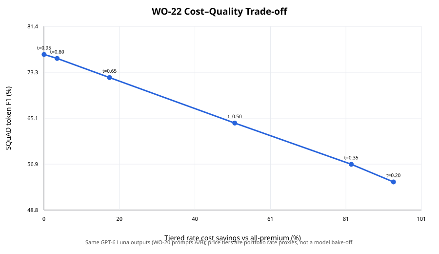

# WO-22 · LLM 비용 오토파일럿 (LLM Cost Autopilot)

> 개인 프로젝트 · 대응 직군: AI 엔지니어, MLOps · 데이터: SQuAD 2.0 dev, [CC BY-SA 4.0](https://rajpurkar.github.io/SQuAD-explorer/)

## 문제 정의

모든 요청을 높은 비용 경로로 보내면 비용이 커지고, 쉬워 보이는 질문을 저비용 경로에 보내면 품질을 잃을 수 있습니다. 의미 기반 캐시(semantic cache)도 비슷한 질문을 잘못 같은 요청으로 판단하면 오답을 돌려줍니다. WO-22는 WO-20의 검증된 질문·응답 기록을 활용해 난이도 라우팅과 의미 캐시의 비용·품질 trade-off를 측정합니다.

WO-18이 장애조치·속도 제한·사용량 회계라는 게이트웨이 신뢰성을 확인했다면, WO-22는 비용 정책에서 생기는 품질 저하와 오답 캐시 위험을 수치로 드러냅니다.

## 가설

- 질문 텍스트로 저비용 응답의 품질 위험을 예측해 라우팅하면, 전체 고비용 기준선보다 일부 비용을 줄일 수 있습니다.
- 분류기가 쉬운 요청을 어렵다고 판단하면 비용이 늘고, 어려운 요청을 쉽다고 판단하면 품질이 낮아집니다.
- 의미 기반 캐시는 반복 요청에서 비용을 추가로 줄일 수 있지만, 테스트 정밀도가 검증 기준을 통과하지 못하면 품질 손실을 일으킬 수 있습니다.

## 접근 — 시도 순서

1. **기존 실험 자산 재사용:** SQuAD 2.0 dev 11,873문항과 WO-20의 프롬프트 A/B GPT-6 Luna 응답을 사용했습니다. 새 모델 호출이나 추가 과금은 없었습니다. 두 응답은 서로 다른 모델 결과가 아니라 같은 모델의 프롬프트 변형입니다.
2. **비용 경로 구성:** 경제 경로 단가는 WO-20의 GPT-6 Luna 입력/출력 단가를, 프리미엄 경로 단가는 WO-18 mock 제공자의 합성 단가를 가져왔습니다. 이 차이는 비용 시나리오의 가정으로만 쓰며, 서로 다른 실제 모델 가격 비교로 해석하지 않습니다.
3. **난이도 분류:** 문서 제목 단위로 학습/테스트를 나누고, 학습 응답에서 프롬프트 A의 SQuAD token F1이 0.80 이상인 질문을 “경제 경로 적합”으로 라벨링했습니다. 테스트 정답은 임계값 학습에 사용하지 않았습니다.
4. **첫 캐시 평가 수정:** 처음에는 가능한 모든 오답 이웃을 각각 precision 분모에 넣어 실제 top-1 조회보다 오답 후보 수가 과도하게 반영됐습니다. 캐시가 실제로 선택하는 top-1 이웃 대조로 바꾸고, 정확 일치 캐시가 먼저 처리할 동일 문구 질문은 semantic 후보에서 제외했습니다.
5. **검증 결과:** 분류기 확률 임계값 0.50에서는 혼합 단가 프로필 비용이 51.04% 줄었고 F1은 12.22%p 낮아졌습니다. WO-03 방식의 99.5% 검증 정밀도 문턱은 train에서 통과했지만 독립 test에서 top-1 정밀도 90.49%로 재현되지 않았습니다. 캐시는 비용 절감뿐 아니라 오답 재사용 품질도 함께 공개합니다.

## 데이터

공식 SQuAD 2.0 dev 전체 11,873문항을 사용하고, 문서 제목 단위 분리로 train 8,915문항(26개 제목), test 2,958문항(9개 제목)을 만들었습니다. SQuAD 원본 파일과 WO-20 예측 기록은 Git에 포함하지 않습니다. [데이터 준비 방법](data/README.md)에 공식 파일 검증과 응답 기록 재사용 절차가 있습니다.

응답 기록은 WO-20의 A/B 프롬프트 쌍이며 모두 GPT-6 Luna에서 생성됐습니다. A/B 점수는 정책 경로 품질의 대리값으로 사용합니다. 따라서 이 결과를 두 실제 모델의 성능 비교로 일반화하지 않습니다.

## 파이프라인

`SQuAD + WO-20 A/B 응답 → 문서 제목 그룹 분리 → TF-IDF 난이도 분류기 → 비용·SQuAD 품질 점수 → 임계값 곡선 → 의미 이웃 top-1 정밀도/재생 시뮬레이션`

`src/cost.py`는 WO-20 GPT-6 Luna 요율과 WO-18 mock 요율을 각각 가져옵니다. `src/semantic_cache.py`는 WO-03의 precision-gated cosine threshold 선택 흐름을 재사용하고, 질문 단위 top-1 검색을 시험합니다. 실제 API 요청은 하지 않습니다.

## 결과 (Ship Gate 표)

| 지표 | 목표 | 실제 |
|---|---|---|
| 모든 프리미엄 vs 라우팅 비용·품질 | 비교표와 F1/EM 포함 | test 2,958건. all-premium F1 76.46%, 비용 $1.7182; 임계값 0.50 라우팅 F1 64.24%, 비용 $0.8412 (**비용 −51.04%, F1 −12.22%p**, paired bootstrap 95% CI [−13.35, −11.04]%p) |
| 분류 오류 유형별 영향 | 쉬움→프리미엄, 어려움→경제 분리 | 쉬운데 프리미엄으로 보낸 478건: 추가 비용 프로필 차액 $0.2639, B의 평균 F1 우위는 −2.17%p. 어려운데 경제로 보낸 851건: 평균 F1 손실 43.70%p, 혼합 프로필 회피 비용 차액 $0.4541 |
| 캐시 추가 효과 | 추가 비용과 품질 영향을 분리 | 통제된 same-intent 2회차 재생에서 추가 절감 **49.86%**($0.8388); 캐시 후 F1 59.78%(라우팅 64.24%보다 −4.46%p). test top-1 precision 90.49%로 99.5% 안전 기준 미달 |
| 비용-품질 임계값 곡선 | 여러 임계값에서 비교 | 임계값 0.20→0.95 범위에서 F1 53.75→76.45%, 비용 절감 93.50→0.04%. [곡선 SVG](results/cost_quality_curve.svg) |

**측정 방식**: 실제 호출 대신 WO-20의 기존 GPT-6 Luna 응답을 재사용하고, 비용은 WO-20의 $0.10/$0.50 per million-token 및 WO-18의 $2/$8 per million-token 단가 프로필로 계산했습니다. 비용 절감 폭은 이 프로필 차이에 민감하며 실제 공급자 간 모델 비교·청구액을 뜻하지 않습니다.

같은 프리미엄 단가를 모든 응답에 적용하면 라우팅 비용은 $1.7290으로 all-premium $1.7182보다 약 0.63% 높았습니다. 관측된 51.04% 절감은 같은 모델 응답에 기존 프로젝트의 서로 다른 비용 프로필을 대응한 시뮬레이션 결과입니다.

### 라우팅 임계값 곡선



### 주요 세그먼트

| 정책 | 전체 F1 | 답변 가능 F1 | 답변 불가능 F1 | 답변 불가능 abstention 비율 |
|---|---:|---:|---:|---:|
| all-economy A | 53.36% | 73.43% | 33.71% | 33.71% |
| all-premium B | 76.46% | 80.36% | 72.64% | 72.64% |
| router 0.50 | 64.24% | 76.22% | 52.51% | 52.51% |

캐시 train 검증 정밀도는 99.71%였지만 held-out top-1 정밀도는 90.49%로 떨어졌습니다. 해당 test replay의 2,958개 same-intent 변형 중 2,664개는 올바른 캐시 이웃을 골랐고, 25,014개 다른 질문 후보 중 잘못된 top-1 재사용 사례가 280건이었습니다. 이 오답 재사용 사례의 평균 F1은 정답 경로 63.19%에서 재사용 응답 16.11%로 떨어졌습니다. 후보 pool은 동일 문단 요청이 미리 들어 있는 warm-cache 시나리오이므로 재사용률은 운영 트래픽 예측이 아닙니다. 따라서 계산된 49.86% 추가 비용 절감은 품질 안전 기준을 충족한 배포 절감으로 주장하지 않습니다.

## 시행착오와 의사결정

- 캐시의 첫 평가 방식은 모든 다른 질문을 독립 오답 후보로 계산해 top-1 검색 선택 규칙과 맞지 않았습니다. 후보가 아니라 쿼리별 top-1 결과를 검증하도록 바꿨습니다.
- 그 다음 검증 세트에서는 precision 99.71%로 통과했지만 분리된 test에서는 90.49%였습니다. 임계값을 test에 맞춰 재조정하지 않고 기준 미달과 품질 저하를 결과로 남겼습니다.
- 경제/프리미엄 단가 프로필은 기존 WO-20 및 WO-18 값의 출처를 그대로 유지했습니다. 같은 프리미엄 단가 민감도에서는 비용 절감이 사라져 비용 이득이 단가 차이 가정에 의존함을 명시했습니다.

## 측정 경계 (한계)

- **측정 방식**: SQuAD 정답과 저장된 같은 모델의 프롬프트 A/B 응답으로 품질을 평가하고, 기존 프로젝트 요율로 비용을 산출한 오프라인 시뮬레이션입니다.
- **다음 단계**: 실측 저비용/고비용 모델 응답으로 모델 간 품질·비용 프로필을 검증하고, 정밀도 기준을 만족하는 캐시 scope/embedding을 별도 holdout에서 시험합니다.
- 현재 라우터는 질문 텍스트 TF-IDF 모델이며, 실제 운영 요청 분포·지연·캐시 임베딩 연산비·장기 반복률을 측정하지 않았습니다.
- 캐시 재생은 같은 SQuAD 질문의 문구 변형과 같은 문단 안의 hard-negative 질문을 통제해 만들고, 해당 문단의 후보 요청이 미리 캐시에 있는 warm-cache 조건으로 평가했습니다. 운영 트래픽의 재사용률 추정치가 아닙니다.

## 실행

프로젝트 폴더에서 데이터를 준비하고 실행합니다.

```bash
docker compose run --build --rm download
cp ../wo-20-prompt-ab-platform/results/predictions.jsonl data/model_predictions.jsonl
docker compose run --build --rm test
docker compose run --rm experiment
```

원본 JSON과 prediction log는 `.gitignore`에 포함됩니다. 전체 지표는 `results/experiment_results.json`, 비용-품질 곡선은 `results/cost_quality_curve.svg`에 기록됩니다.

## 개발 방식 (AI 활용 구분)

| 직접 작성한 것 | Codex가 생성한 것 |
|---|---|
| WO-22 범위와 비용/품질 비교 질문, 기존 데이터·요율 재사용 원칙 | 데이터 짝짓기, 분류·캐시 평가 코드, 통계 집계, 테스트와 실험 문서 초안 |

## 용어집

| 용어 | 뜻 |
|---|---|
| 비용-품질 절충 (Cost–Quality Trade-off) | 비용을 낮출수록 응답 품질이 어떻게 바뀌는지를 여러 라우팅 임계값으로 비교합니다. |
| 대규모 언어 모델 (Large Language Model, LLM) | 이 실험의 기존 답변 기록을 만든 모델 API 유형입니다. WO-22에서는 API를 다시 호출하지 않습니다. |
| 문서 그룹 분리 (Group Split) | 같은 문서 제목의 질문이 train과 test에 동시에 들어가지 않도록 나누는 방법입니다. 질문 문맥 누출을 줄입니다. |
| 시맨틱 캐시 (Semantic Cache) | 문구가 달라도 의미가 가깝다고 판단한 이전 응답을 재사용하는 캐시입니다. 잘못된 top-1 선택은 오답과 품질 손실을 만듭니다. |
| 시뮬레이션 단가 (Synthetic Price Profile) | WO-18/20의 기존 단가를 경로별로 적용한 비용 가정입니다. 이 프로젝트에서는 실제 청구 금액을 의미하지 않습니다. |
| 정확 일치 캐시 (Exact Cache) | 정규화한 요청 문자열이 같은 경우 이전 응답을 반환합니다. semantic 후보보다 먼저 처리한다고 가정합니다. |
| 정밀도 (Precision) | 캐시가 반환한 이웃 중 재사용 가능한 이웃의 비율입니다. 오답 재사용 위험을 제어하는 기준입니다. |
| 토큰 F1 (Token F1 Score) | 답변과 정답의 토큰 겹침을 precision·recall 조화평균으로 평가합니다. |
| TF-IDF (Term Frequency–Inverse Document Frequency) | 질문 단어의 상대적 중요도를 벡터로 만들어 라우터 분류와 질문 유사도 비교에 사용합니다. |
| top-1 검색 (Top-1 Retrieval) | 후보 중 유사도가 가장 높은 하나를 선택하는 검색입니다. 캐시가 실제 반환하는 단일 후보 기준으로 정밀도를 계산합니다. |

## English Technical Summary

WO-22 reuses all 11,873 SQuAD 2.0 dev questions and the stored prompt A/B answers from WO-20's GPT-6 Luna run. It trains a question-text TF-IDF router on an article-title split and evaluates a conservative semantic-cache threshold. At a 0.50 router cutoff, the routed policy reduced modeled cost by 51.04% versus the all-premium profile while token F1 fell by 12.22 points (76.46% to 64.24%). The six-cutoff curve ranges from 93.50% modeled savings at 53.75% F1 to 0.04% savings at 76.45% F1. The cache threshold met a 99.5% precision gate on training articles (99.71%) but achieved only 90.49% held-out top-1 precision; wrong reuse reduced F1 by 4.46 points in the controlled replay. The estimated 49.86% second-pass savings therefore does not pass the held-out quality gate. A/B are prompts to the same model, and the two rate profiles are copied from WO-20 and WO-18; these figures are a policy simulation, not a comparison of distinct live models or billed costs.
